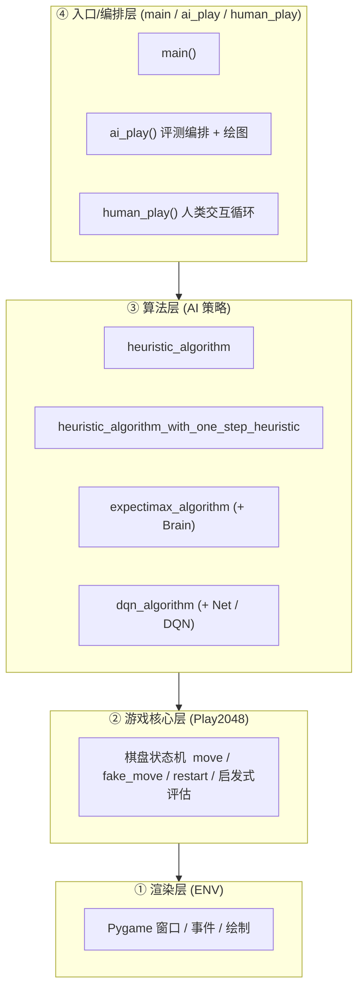
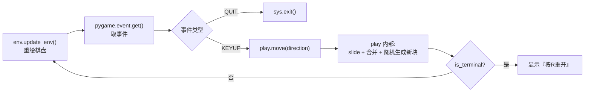

# 01 · 整体架构

## 1.1 项目定位

本项目是一个"游戏 + AI 实验台"：在其上既可以**人类手动游玩**，也可以让多种**自动策略**（启发式搜索、Expectimax、DQN）驱动游戏自动运行，并统计每局得分用于策略对比。

整个仓库是一个**单体（monolithic）Python 脚本项目**，所有逻辑集中在一个文件 [play.py](../play.py) 中，没有拆分为多个包或模块。

## 1.2 分层结构

代码在逻辑上可分为四层，自底向上依次为：



- **① 渲染层 `ENV`**：封装 Pygame 窗口、事件处理与棋盘绘制。
- **② 游戏核心层 `Play2048`**：维护棋盘状态、实现移动合并规则、终局判定，并提供启发式评估函数。
- **③ 算法层**：四个算法函数，通过 `Play2048` 的 `fake_move` 试算走法、选择方向、驱动 `move` 真正落子。
- **④ 入口/编排层**：`human_play` 处理键盘交互；`ai_play` 批量运行算法并绘制柱状图；`main` 组装对象并选择运行模式。

## 1.3 核心对象与数据流

### 关键对象

| 对象 | 类型 | 职责 |
| --- | --- | --- |
| `play` | `Play2048` 实例 | 纯逻辑：棋盘矩阵、得分、终局状态、走子与模拟走子 |
| `env` | `ENV` 实例 | 渲染与事件：持有 `play` 引用，负责把棋盘画到屏幕 |

`ENV` 通过 `self.play` 反向引用游戏对象，形成"渲染层读取核心层状态"的单向依赖。

### 主循环数据流



三种模式共用同一循环骨架：
- **人类模式**：等待按键 → 调用 `move`；
- **AI 模式**：用启发式/搜索评估四个方向 → 选择最优方向 → 调用 `move`；
- **DQN 模式**：将棋盘扁平化为状态向量 → 神经网络选动作 → `move` 并存入经验回放。

## 1.4 棋盘表示与移动语义（核心设计）

- 棋盘是 `numpy` 的 `int` 二维数组，形状 `(width, width)`，`0` 表示空格。
- 所有方向移动最终都归约为"**向左滑动**"：
  - `left`：直接对原数组操作；
  - `right`：对数组做 `np.flip(..., axis=1)`，得到一个**视图（view）**，在视图上"向左滑"等价于在原始棋盘上向右滑；
  - `up`：取转置视图 `playground.T`；
  - `down`：`np.flip(..., axis=0).T`。

> 设计要点：`np.flip` / `.T` 返回的是**视图而非副本**，`__realize_slide` 在原位修改视图时会同步写回真实棋盘，因此无需额外的"反转回来"步骤，也避免了大额内存拷贝。见 [play.py](../play.py#L386-L439)。

## 1.5 状态与终局判定

- 每次成功移动后，`__random_generate` 随机在空格生成一个 `2`（90%）或 `4`（10%）。
- 终局判定在"仅剩 1 个空格"的边界下触发：遍历四个方向做 `fake_move`，若没有任何方向能产生空格或变化，则判定 `terminal`。见 [play.py](../play.py#L78-L95)。
- 移动失败（棋盘未发生变化）时不计分、不生成新块。见 [play.py](../play.py#L409-L415)。

## 1.6 入口与运行模式选择

`main()` 的当前实现为：

```python
def main():
    play = Play2048(width=4, debug=False)
    env = ENV(play)
    # human_play(env)
    # ai_play(env)
    dqn_algorithm(env)
```

即：**当前默认启动的是 DQN 模式**，人类模式与 ai_play 评测模式被注释掉。切换方式见 [05-run-and-test.md](./05-run-and-test.md)。

## 1.7 代码规模分布（按职责）

| 职责 | 主要行区间 | 说明 |
| --- | --- | --- |
| 常量与 `ENV` | L13–L58 | 渲染层 |
| `Play2048` | L60–L448 | 核心层（含 3 个启发式函数） |
| 计时装饰器 `coast_time` | L450–L457 | 通用工具 |
| 人类模式 | L459–L482 | 交互循环 |
| 启发式两版 | L484–L628 | 算法层 |
| Expectimax | L630–L723 | 算法层 |
| DQN | L725–L866 | 算法层 |
| 评测编排 `ai_play` | L868–L915 | 入口层 |
| `main` / `__main__` | L919–L927 | 入口层 |

> 详细的类与函数签名、参数含义请见 [02-core-modules.md](./02-core-modules.md) 与 [03-ai-algorithms.md](./03-ai-algorithms.md)。
