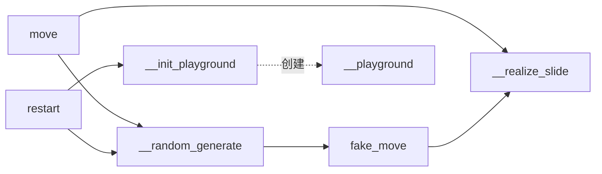

# 02 · 游戏核心模块

本文件说明渲染层 `ENV` 与核心层 `Play2048` 的职责、关键方法与内部实现。

---

## 2.1 `ENV` — 渲染与事件层

位置：[play.py](../play.py#L15-L58)

### 类常量

| 常量 | 值 | 用途 |
| --- | --- | --- |
| `WHITE` / `BLACK` / `RED` / `GREEN` / `BLUE` / `YELLOW` | RGB 元组 | 配色方案 |
| `WINDOW_WIDTH` | `600` | 窗口边长（像素） |

### `__init__(self, play)`

初始化 Pygame 并创建窗口。

```python
def __init__(self, play):
    pygame.init()
    pygame.event.set_allowed([12, KEYUP])   # 12 == QUIT
    self.play = play
    self.WALL_WIDTH = 450 // play.width      # 单格像素宽度
    self.screen = pygame.display.set_mode((self.WINDOW_WIDTH, self.WINDOW_WIDTH))
```

- 绑定传入的 `Play2048` 实例；
- 根据棋盘宽度计算每格像素宽 `WALL_WIDTH`（`450 // width`）。

### `update_env(self)`

将当前棋盘与分数绘制到窗口，无返回值。

主要步骤：
1. 白底填充；
2. 绘制外边框；
3. 在顶部居中绘制 `得分：xxxx`（字体 `simsunnsimsun`，紫色 `(106,90,205)`）；
4. 双重循环遍历棋盘，非零格绘制黄色方块及数字，所有格绘制黑色网格线；
5. 若 `play.is_terminal()` 为真，在左上角绘制 **"按R重开"** 提示。

> 注意：绘制逻辑中坐标使用 `i` 作为 x、`j` 作为 y（行列相对窗口做了旋转映射），显示效果与逻辑矩阵一致。

---

## 2.2 `Play2048` — 游戏状态机

位置：[play.py](../play.py#L60-L448)

### 类属性

```python
DIRECTIONS = ['left', 'right', 'up', 'down']
```

四个合法移动方向，被所有算法统一复用。

### `__init__(self, width, debug=False)`

```python
def __init__(self, width, debug=False):
    self.__debug = debug
    self.__terminal = False
    self.__playground = None
    self.width = width
    self.__score = 0
    self.__init_playground()
    self.__random_generate(n=2)   # 初始生成两个方块
```

- `width`：棋盘边长；
- `debug`：为真时打印详细过程日志；
- 初始化时随机生成 `n=2` 个方块。

> 命名说明：`__` 前缀（如 `__playground`）触发 Python 名称改写（name mangling），这些成员为类私有，外部只能通过公开方法访问。

### 私有方法

#### `__init_playground(self)`
创建 `width × width` 的全零 `int` 矩阵。见 [play.py](../play.py#L75-L76)。

#### `__random_generate(self, n=1)`
在随机空格生成新方块。见 [play.py](../play.py#L78-L95)。

- 收集所有空格 `np.argwhere(playground == 0)`；
- 空格少于 `n` 时直接置 `terminal = True` 返回；
- 用 `random.sample` 不重复抽取 `n` 个位置，每格以 **90% 概率生成 2、10% 概率生成 4**；
- 边界优化：当**只剩 1 个空格**时，额外做一次四方向 `fake_move`，若无任何方向能腾出空格则判定终局。

#### `__realize_slide(self, ground)` → `int`
**核心合并算法**：对逐行"向左压缩 + 相邻合并"并返回本步得分。见 [play.py](../play.py#L97-L118)。

算法逐行执行：
1. 过滤出该行非零元素 `tmp`；
2. 从左到右扫描，若 `tmp[tip] == tmp[tip+1]` 则合并：得分累加 `tmp[tip]`，值翻倍 `tmp[tip] *= 2`，删除后一个元素；
3. 将 `tmp` 写回行首，其余补 0。

> 由于"右/上/下"方向已在 `move`/`fake_move` 中通过翻转/转置视图映射为"左滑"，此方法只需实现单一方向的滑动逻辑。

### 公开读取方法

| 方法 | 返回 | 说明 |
| --- | --- | --- |
| `get_score()` | `int` | 当前累计得分 |
| `get_playground()` | `np.ndarray` | 当前棋盘（**返回内部引用**，调用方需自行注意不要误改） |
| `is_terminal()` | `bool` | 是否已终局 |

### 启发式评估函数

项目内含三个启发式函数，分别用于不同算法：

#### `heuristic1(self, ground)` — 加权位置 + 平滑度惩罚
位置：[play.py](../play.py#L129-L150)

- `score`：越靠左上角权重越高（权重 `4^(2*width-2-i-j)`），鼓励大数集中在角/边；
- `penalty`：相邻格差值之和（平滑度惩罚）减去 `2 × 空格数`；
- 返回 `score - penalty`。

> 注意：`penalty` 内部硬编码 `range(0, 4)` 双重循环，仅在 `width == 4` 时语义正确。

#### `heuristic(self, ground)` — 多特征线性组合（主用）
位置：[play.py](../play.py#L152-L205)

聚合四个特征：
| 特征 | 计算方式 |
| --- | --- |
| `assess_score` | 当前得分 |
| `assess_empty` | 空格数量 |
| `assess_succession` | 相邻相同方块对数量（连续性） |
| `assess_corner` | 最大方块到四角的曼哈顿距离取均值（越小越"贴角"） |

默认权重 `weights = [1, 1, 1, 1]`，返回四者加权和。该函数是 Expectimax 与"一步启发式"算法的核心评估函数。

#### `heuristic3(self, ground, commonRatio=0.25)` — 多方向线性加权
位置：[play.py](../play.py#L207-L384)

对 8 种扫描路径分别计算 `linearWeightedVal`（按 `commonRatio` 递减的指数权重），取最大值。用于评估大数的"方向性排布"。

> 现状：`heuristic1` 与 `heuristic3` 在当前代码中**未被任何算法调用**，属于保留的实验性实现；主流程实际使用的是 `heuristic`。

### 走子方法

#### `move(self, direction)` → `int`
**真实落子**。位置：[play.py](../play.py#L386-L418)

流程：
1. 若已终局则打印提示并返回；
2. 备份当前棋盘；
3. 按方向将棋盘映射为其视图（左/右/上/下），调用 `__realize_slide` 得到本次得分；
4. 若棋盘与备份相同 → `move_success = False`（无有效移动）；
5. 若有效：累加得分、调用 `__random_generate()` 生成新块；
6. 返回本次得分。

#### `fake_move(self, direction, current_playground=None)` → `(np.ndarray, int)`
**模拟落子（不改变真实状态）**。位置：[play.py](../play.py#L420-L439)

- 复制一份棋盘后执行与 `move` 相同的滑动逻辑；
- 返回 `(next_playground, score)`；
- 是 AI 算法"试算每个方向"的基础设施。

> `move` 与 `fake_move` 的区别：前者就地修改真实状态并生成新块，后者只做纯计算。

#### `restart(self)`
重置终局标志与得分为 0，重建棋盘并生成 2 个方块。位置：[play.py](../play.py#L441-L448)。

---

## 2.3 `coast_time` — 耗时统计装饰器

位置：[play.py](../play.py#L450-L457)

```python
def coast_time(func):
    def fun(*args, **kwargs):
        t = time.perf_counter()
        result = func(*args, **kwargs)
        print(f'func {func.__name__} coast time:{time.perf_counter() - t:.8f} s')
        return result
    return fun
```

以装饰器形式包裹算法函数（`heuristic_algorithm`、`expectimax_algorithm`），在函数结束时打印其总耗时。

> 说明：由于算法函数是**无限循环**（靠 `episode >= MAX_EPISODE` 才返回），该耗时实际统计的是"整个评测跑完所需时间"。

---

## 2.4 相关方法调用关系


