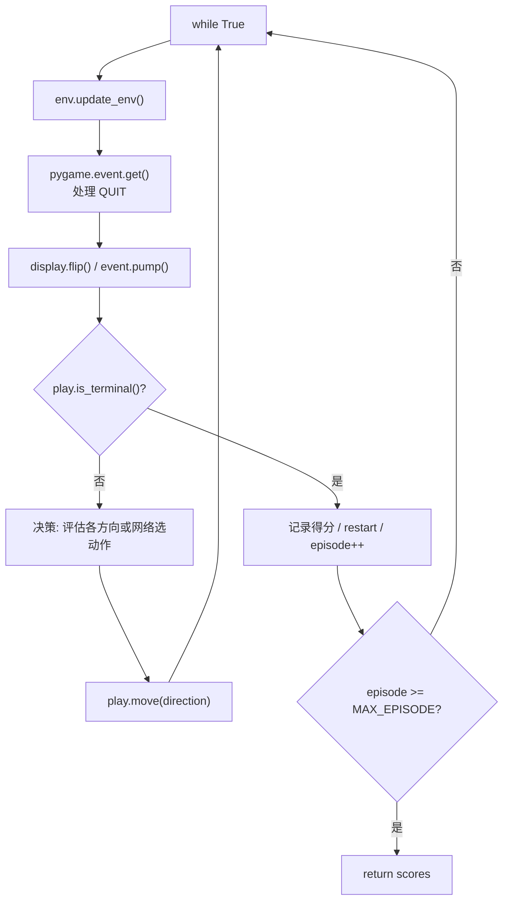

# 03 · AI 算法模块

本文件说明四种自动游玩策略及其评测入口。所有算法函数签名统一为：

```python
algorithm(env, config) -> scores   # scores: List[int]，每局最终得分
```

它们共享同一"游戏主循环骨架"（重绘 → 取事件 → 判断终局 → 决策 → 落子），并通过 `env.update_env()` 中 `env.play` 直接操控游戏对象。

---

## 3.1 人类交互模式 · `human_play(env)`

位置：[play.py](../play.py#L459-L482)

- 死循环渲染窗口并监听键盘事件；
- 方向键 `← → ↑ ↓` 分别触发 `play.move(...)`；
- `R` 键触发 `play.restart()`；
- 窗口关闭事件（`QUIT`）调用 `sys.exit()`。

> 该函数**不会自动结束**，需手动关窗退出。

---

## 3.2 加权启发式 · `heuristic_algorithm(env, weights)`

位置：[play.py](../play.py#L484-L584)（被 `@coast_time` 装饰）

- `weights` 为长度 4 的列表，对应四个特征：`[assess_score, assess_empty, assess_succession, assess_corner]`；
- 对每个方向做 `fake_move`，若棋盘无变化则该方向评估为 `-99999999`（排除）；
- 否则计算四项特征的加权和：
  - `assess_empty` 与 `assess_succession` 均使用"移动后 - 移动前"的**增量差值**；
  - `assess_corner` 取最大方块到四角距离的最大值的均值；
- 在所有评估值最大的方向中**随机**选一个（`random.choice(np.where(...))`）落子；
- 内部定义了局部的 `culculate_succession` 用于计算连续性。

> 函数内 `if True: ... else: ...` 结构中 `else` 分支为死代码（保留的备选实现）。

---

## 3.3 一步启发式 · `heuristic_algorithm_with_one_step_heuristic(env, x=None)`

位置：[play.py](../play.py#L586-L628)

- 逻辑与 `heuristic_algorithm` 类似，但评估函数改为直接调用 `play.heuristic(next_playground)`；
- 即基于"走一步后的棋盘"用 `Play2048.heuristic` 综合打分；
- 参数 `x` 未使用。

---

## 3.4 Expectimax 搜索 · `expectimax_algorithm(env, max_depth)`

位置：[play.py](../play.py#L630-L723)（被 `@coast_time` 装饰）

采用 Expectimax（期望极大）博弈搜索：**Max 节点（玩家选方向）** 与 **Chance 节点（随机生成 2/4）** 交替。

### 内部类 `Brain` — 记忆化缓存
位置：[play.py](../play.py#L634-L649)

| 成员 | 说明 |
| --- | --- |
| `__memory` | `OrderedDict`，键为状态哈希，值为评估结果 |
| `__max_memory` | 容量上限（实例化时传 10000） |
| `remember(something, value)` | 写入缓存；超容量时按 FIFO 淘汰最旧项 |
| `recall(something)` | 命中返回值，否则返回 `None` |

### 递归函数 `search(ground, depth, move=False)`
位置：[play.py](../play.py#L651-L676)

- **终止条件**：`depth == 0`，或 `move=True` 且 `play.is_terminal()` → 返回 `play.heuristic(ground)`；
- **Max 层（`move=True`）**：遍历四方向，跳过无效移动，取子节点评估的最大值；结果用 `brain` 缓存（键为 `hash(str((child, depth-1)))`）；
- **Chance 层（`move=False`）**：枚举所有空格，分别以 0.9 概率放 2、0.1 概率放 4，按空格数求期望：

  ```
  alpha += 0.9 * search(c1, depth-1, True)/len(zeros)
         + 0.1 * search(c2, depth-1, True)/len(zeros)
  ```

- 主循环用 `search(next_playground, max_depth)` 评估每个方向并落子。

> 复杂度较高：搜索深度 4 时开销随空格数指数增长，`Brain` 记忆化是主要性能优化。

---

## 3.5 DQN 深度强化学习 · `dqn_algorithm(env, x=None)`

位置：[play.py](../play.py#L725-L866)

> 进入该函数会**将全局 `MAX_EPISODE` 改写为 10000**（训练所需）。

### 超参数

| 名称 | 值 | 含义 |
| --- | --- | --- |
| `BATCH_SIZE` | 128 | 每次学习采样批量 |
| `LR` | 0.01 | 学习率 |
| `GAMMA` | 0.90 | 折扣因子 |
| `EPISILO` | 0.1 | ε-greedy 探索率 |
| `MEMORY_CAPACITY` | 2000 | 经验回放池容量 |
| `Q_NETWORK_ITERATION` | 100 | 目标网络同步间隔 |

### 内部类 `Net(nn.Module)` — Q 网络
位置：[play.py](../play.py#L741-L759)

全连接结构：`NUM_STATES(=width²) → 50 → 30 → NUM_ACTIONS(=4)`，中间使用 ReLU 激活，权重以 `normal_(0, 0.1)` 初始化。

### 内部类 `DQN`
位置：[play.py](../play.py#L761-L817)

| 成员/方法 | 说明 |
| --- | --- |
| `eval_net` / `target_net` | 评估网络与目标网络（结构相同） |
| `memory` | 形状 `(2000, NUM_STATES*2 + 2)` 的经验回放数组（状态、动作、奖励、下一状态） |
| `optimizer` | `Adam` |
| `loss_func` | `MSELoss` |
| `choose_action(state)` | ε-greedy：以 `EPISILO` 概率随机、否则取 `eval_net` 最大值动作 |
| `store_transition(...)` | 将转移元组写入环形缓冲区，计数器自增 |
| `learn()` | 每隔 `Q_NETWORK_ITERATION` 步同步目标网络；采样 batch，计算 `q_eval`、`q_target = reward + GAMMA * max(q_next)`，反向传播更新 |

### 辅助函数 `get_state()`
位置：[play.py](../play.py#L819-L823)

将棋盘展平为一维，做变换 `log(value + 1) / 16` 归一化，作为网络输入。

### 训练主循环
位置：[play.py](../play.py#L832-L866)

```
选动作(choose_action) → 落子(move)取奖励 → 计算 next_state
→ 存经验(store_transition) → 当经验池满时 learn() → 更新 state
```

每局结束打印 `[dqn]episode / score / step / max_block`，并 `restart`；达到 `MAX_EPISODE` 后返回得分列表。

> `choose_action` 中的 `np.random.randn() <= EPISILO` 使用了标准正态分布采样，与常见的均匀分布 `rand()` 写法不同，实际探索概率约 0.54，属实现细节上的偏差。

---

## 3.6 评测编排 · `ai_play(env)`

位置：[play.py](../play.py#L868-L915)

负责批量运行多种算法配置并可视化对比：

```python
configs = []
configs.append((expectimax_algorithm, 4))   # 当前启用
# 其余启发式配置均被注释
```

- `configs` 为 `(算法函数, 配置)` 列表，名称标记 `H+权重串` 或 `E+深度`；
- 依次运行每个算法（每次返回各局得分），统计 `min / max / mean / std`，并计算变异系数 `cv = std / min`；
- 最后用 `matplotlib` 绘制 2×2 子图柱状图：**min / max / mean / cv**，并 `plt.show()`。

> 由于 `ai_play` 会顺序运行所有配置且算法本身是无限循环，运行时间较长。

---

## 3.7 算法对比总览

| 算法 | 决策依据 | 是否需要训练 | 关键内部结构 | 返回 |
| --- | --- | --- | --- | --- |
| `heuristic_algorithm` | 四特征加权（增量） | 否 | 局部 `culculate_succession` | 每局得分列表 |
| `heuristic_algorithm_with_one_step_heuristic` | `Play2048.heuristic` | 否 | — | 每局得分列表 |
| `expectimax_algorithm` | Expectimax 搜索 `max_depth` 层 | 否 | `Brain` 记忆化 | 每局得分列表 |
| `dqn_algorithm` | DQN 网络 Q 值 | 是（在线学习） | `Net` / `DQN` / 经验回放 | 每局得分列表 |

## 3.8 通用循环骨架


