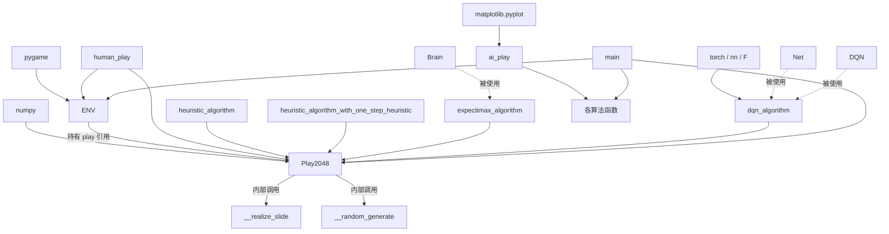

# 04 · 依赖关系

## 4.1 外部依赖

声明于 [requirements.txt](../requirements.txt)，均为固定版本：

| 依赖 | 版本 | 用途 | 使用位置 |
| --- | --- | --- | --- |
| `numpy` | 1.20.2 | 棋盘矩阵运算、翻转/转置视图、argwhere、随机抽样 | `Play2048` 及全部算法 |
| `pygame` | 2.0.1 | 窗口、绘图、键盘与事件处理 | `ENV` 及各主循环 |
| `torch` | 1.8.1+cpu | DQN 神经网络与优化器（CPU 版） | `dqn_algorithm` |
| `matplotlib` | 3.3.2 | 评测结果柱状图可视化 | `ai_play` |

标准库依赖（无需额外安装）：`sys`、`random`、`time`、`collections.OrderedDict`、`pygame.locals`。

> 说明：`torch` 为 CPU 版本（`+cpu`），本项目不涉及 GPU 训练。

## 4.2 内部模块依赖

仓库只有一个业务模块 [play.py](../play.py)（`test.py` 为空文件），因此内部依赖表现为"类与函数之间"的引用关系。

## 4.3 依赖层次与方向

- **底层**：`numpy`、`pygame`、`torch`、`matplotlib`（第三方）。
- **中层**：`Play2048`（纯逻辑，仅依赖 `numpy`）与 `ENV`（渲染，依赖 `pygame` 并持有 `Play2048`）。
- **上层**：四个算法函数，均依赖 `Play2048` 的公开接口
  （`DIRECTIONS`、`fake_move`、`move`、`get_playground`、`heuristic`、`is_terminal`、`restart`、`get_score`）。
- **顶层**：`ai_play` / `main` 编排算法与对象。

依赖方向总体是**自底向上单向依赖**：算法依赖游戏核心，游戏核心依赖 `numpy`；渲染层只被入口/主循环使用，`Play2048` 不反向依赖 `ENV`。

## 4.4 `Play2048` 对外接口被依赖清单

| 接口 | 被哪些算法使用 |
| --- | --- |
| `DIRECTIONS` | 四个算法均使用 |
| `fake_move(direction[, ground])` | 全部算法试算走法 |
| `move(direction)` | 全部算法真实落子 |
| `get_playground()` | 全部算法读取状态 |
| `is_terminal()` | 全部算法终局判定 |
| `heuristic(ground)` | Expectimax、一步启发式 |
| `restart()` | 全部算法新局重置 |
| `get_score()` | 全部算法记录得分 |

## 4.5 版本与环境约束

- 项目 JDK/SDK 设定为 **Python 3.8**（见 [.idea/misc.xml](../.idea/misc.xml)）。
- `numpy==1.20.2`、`torch==1.8.1+cpu` 等版本较旧，安装时需注意与本地 Python 版本的兼容性（例如 `numpy 1.20.x` 对较新的 Python 可能无预编译 wheel）。
- 运行需具备图形环境（Pygame 窗口），在无显示设备的服务器上需配置虚拟显示（如 `SDL_VIDEODRIVER=dummy`）或改用途中逻辑。
